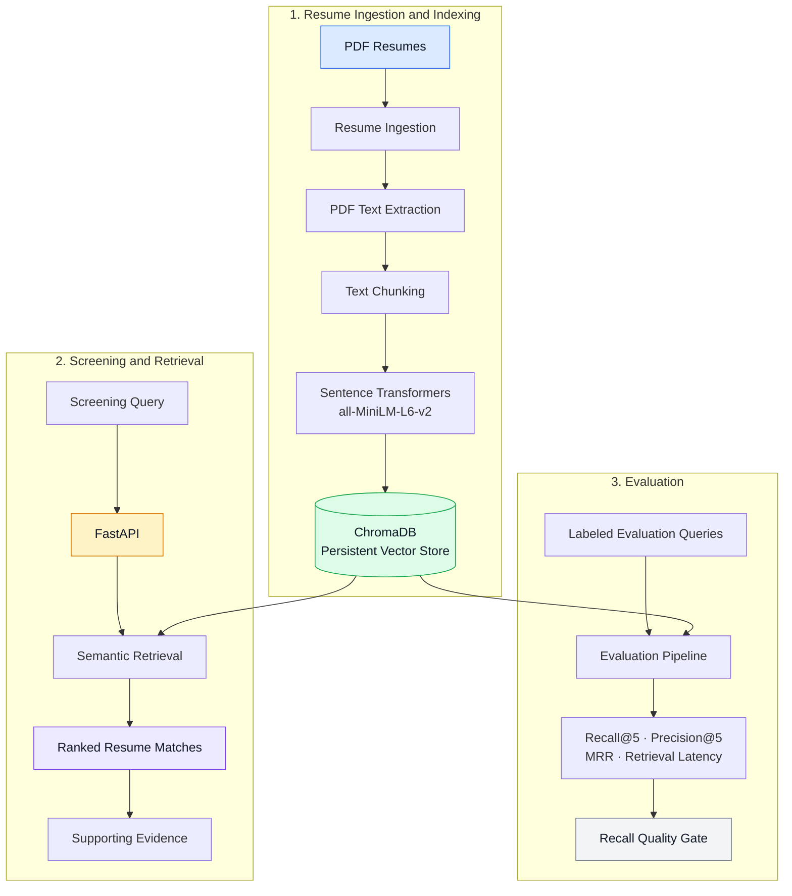
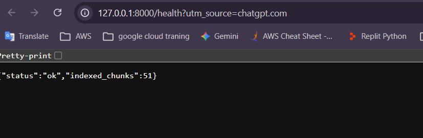
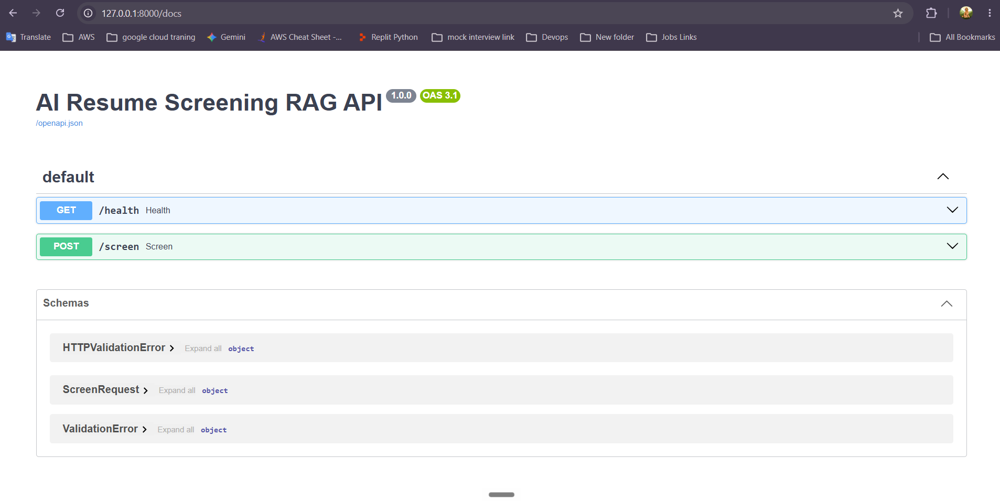
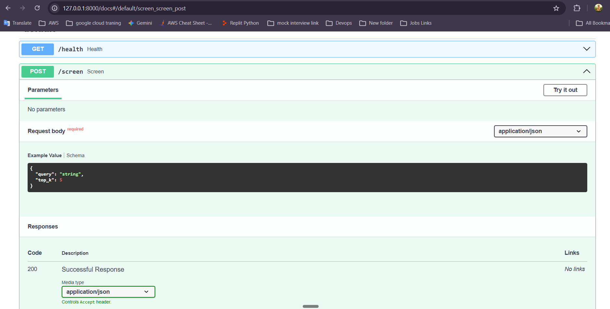
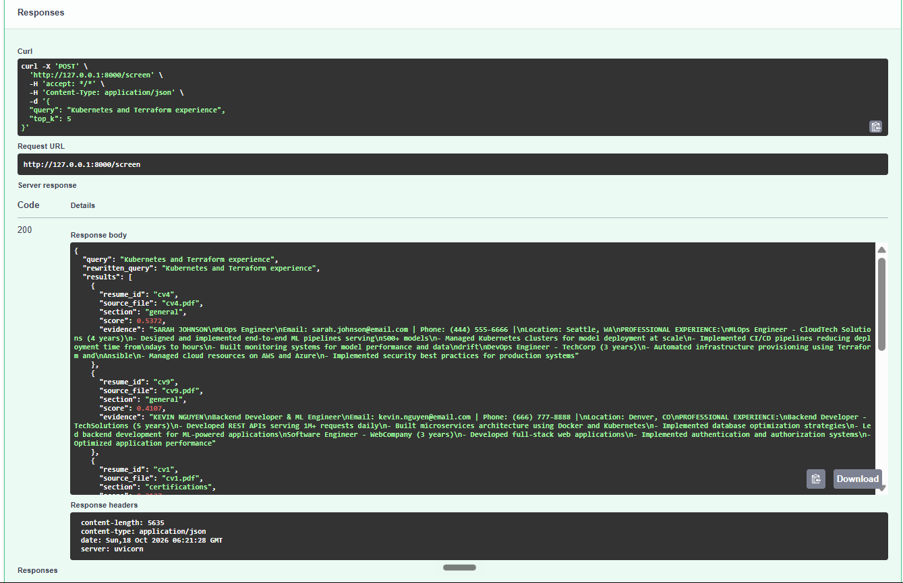
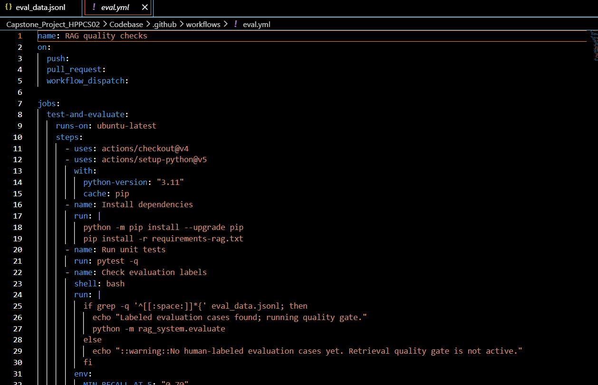
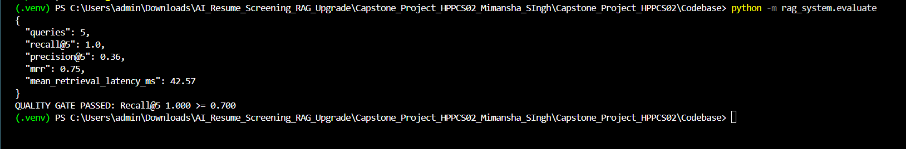
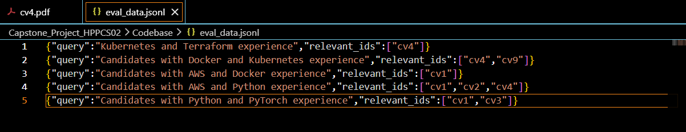

# AI Resume Screening RAG

An AI-powered resume screening prototype that uses semantic retrieval to help identify resumes relevant to a job-related query. The project explores resume PDF ingestion, text chunking, embeddings, vector search with ChromaDB, a FastAPI interface, and retrieval evaluation.

> **Project status:** Prototype for learning and demonstration. It does not make hiring decisions, and it does not currently integrate a language model for answer generation.

## Table of Contents

- [Overview](#overview)
- [System Architecture](#system-architecture)
- [How It Works](#how-it-works)
- [Features](#features)
- [Technology Stack](#technology-stack)
- [Evaluation Results](#evaluation-results)
- [Project Structure](#project-structure)
- [Setup and Usage](#setup-and-usage)
- [API Endpoints](#api-endpoints)
- [Run Tests](#run-tests)
- [Limitations](#limitations)
- [Future Improvements](#future-improvements)
- [Responsible Use](#responsible-use)
- [Author](#author)

## Overview

Reviewing many resumes manually can be time-consuming. This project explores how semantic search can help retrieve resume sections that are relevant to a screening query.

The prototype extracts text from PDF resumes, divides the text into smaller chunks, converts chunks into vector embeddings using Sentence Transformers, and stores them in ChromaDB. A query can then be used to retrieve relevant resume content and return candidate matches with supporting evidence.

This is a **retrieval-focused prototype using RAG concepts**. It does not currently connect a generative language model to produce final generated answers.

## System Architecture

The diagram shows the main ingestion, retrieval, API, and evaluation paths.



## How It Works

1. **Ingest resumes:** Read the available PDF resume files.
2. **Extract text:** Convert PDF content into text.
3. **Chunk text:** Split resume content into smaller sections for retrieval.
4. **Create embeddings:** Use `all-MiniLM-L6-v2` to represent text as vectors.
5. **Store vectors:** Save vectors and related metadata in ChromaDB.
6. **Retrieve matches:** Search indexed content for a user-provided screening query.
7. **Return evidence:** Present retrieved resume matches and supporting text.
8. **Evaluate retrieval:** Compare results with labeled examples and calculate retrieval metrics.

## Features

- PDF resume ingestion and text extraction
- Section/chunk-based resume indexing
- Semantic embeddings with Sentence Transformers
- Persistent vector storage using ChromaDB
- FastAPI health-check and screening endpoints
- Retrieval evaluation using Recall@k, Precision@k, MRR, and latency
- Automated unit tests for evaluation metrics
- GitHub Actions workflow for evaluation

## Technology Stack

| Area | Technology |
|---|---|
| Programming language | Python |
| Embedding model | Sentence Transformers — `all-MiniLM-L6-v2` |
| Vector database | ChromaDB |
| API framework | FastAPI |
| PDF text extraction | PyPDF2 |
| Testing | pytest |
| Continuous integration | GitHub Actions |

## Evaluation Results

A local evaluation run using **five queries** reported the following results:

| Metric | Result |
|---|---:|
| Recall@5 | 1.00 |
| Precision@5 | 0.36 |
| Mean Reciprocal Rank (MRR) | 0.75 |
| Mean retrieval latency | Approximately 50 ms |
| Recall quality gate | Passed (threshold: 0.70) |

These are preliminary results from a small evaluation dataset. The relevance labels are limited and may not include every relevant candidate, so these metrics should not be interpreted as proof of complete recall, overall accuracy, or production readiness. Latency depends on the machine, data, and runtime conditions.

## Project Structure

```text
AI-Resume-Screening-RAG/
├── .gitignore
└── Capstone_Project_HPPCS02/
    ├── Codebase/
    │   ├── .github/
    │   │   └── workflows/
    │   │       └── eval.yml
    │   ├── rag_system/
    │   │   ├── __init__.py
    │   │   ├── api.py
    │   │   ├── evaluate.py
    │   │   ├── ingest.py
    │   │   └── pipeline.py
    │   ├── tests/
    │   │   └── test_metrics.py
    │   ├── eval_data.jsonl
    │   └── requirements-rag.txt
    └── UPGRADE_NOTES.txt
```

The repository may contain additional original project files. Local resume PDFs, the local vector database, and virtual-environment files should remain untracked.

## Setup and Usage

### Prerequisites

- Python 3.10 or newer (Python 3.12 was used during local testing)
- Git
- PDF resumes that you are authorized to process

### 1. Clone the repository

```bash
git clone https://github.com/mimansha0105/AI-Resume-Screening-RAG.git
cd AI-Resume-Screening-RAG
```

### 2. Create and activate a virtual environment

**Windows PowerShell**

```powershell
python -m venv .venv
.\.venv\Scripts\Activate.ps1
```

**macOS/Linux**

```bash
python3 -m venv .venv
source .venv/bin/activate
```

### 3. Install dependencies

```bash
python -m pip install -r Capstone_Project_HPPCS02/Codebase/requirements-rag.txt
```

### 4. Add local test resumes

Place authorized PDF test resumes in:

```text
Capstone_Project_HPPCS02/Codebase/
```

Do not add real, confidential, or personally identifiable candidate resumes to a public repository. The `.gitignore` is intended to exclude local `cv*.pdf` files and the local ChromaDB database; verify the ignore rules before committing any data.

### 5. Ingest resumes

Change to the Codebase directory:

```bash
cd Capstone_Project_HPPCS02/Codebase
```

Run the ingestion module:

```bash
python -m rag_system.ingest
```

The index is created from the PDF files available to the ingestion script. The exact number of indexed resumes and chunks depends on the local input files.

### 6. Run retrieval evaluation

From the Codebase directory:

```bash
python -m rag_system.evaluate
```

The evaluator reports retrieval metrics and checks the configured Recall@5 quality threshold.

### 7. Start the API

From the Codebase directory:

```bash
python -m uvicorn rag_system.api:app --reload
```

Open the interactive API documentation in your browser:

http://127.0.0.1:8000/docs

Keep the server terminal running while testing the endpoints.

## API Endpoints

| Method | Endpoint | Purpose |
|---|---|---|
| `GET` | `/health` | Checks API status and reports indexed chunk count. |
| `POST` | `/screen` | Retrieves resume matches for a screening query. |

Use `/docs` to inspect the request schema for `/screen` and try a query. The API requires a locally built index for meaningful screening results.

## Run Tests

From the Codebase directory:

```bash
python -m pytest -q
```

The project’s metric unit tests can be run with pytest. Test results may vary if the code or environment changes.

## Limitations

- The evaluation dataset is small and does not establish production-level performance.
- Relevance labels may be incomplete; retrieved candidates should be reviewed against the original resumes and job requirements.
- Semantic similarity is not the same as qualification, suitability, or hiring merit.
- The current prototype focuses on retrieval; a generative LLM component is not integrated.
- The prototype has not been presented as a fully secured, production-ready recruitment service.
- PDF formatting, scanned documents, and extraction quality can affect retrieval.
- Retrieval latency and quality depend on the environment and dataset.

## Future Improvements

- Expand the evaluation dataset and review relevance labels.
- Improve precision and ranking quality.
- Explore hybrid keyword and semantic retrieval.
- Add an optional language model for evidence-grounded summaries, with citations to resume passages.
- Add authentication, access controls, structured logging, and deployment hardening.
- Evaluate fairness, privacy, and performance across varied resume formats.

## Responsible Use

Use only resumes you are authorized to process. Avoid committing personal candidate data, secrets, environment files, or local vector-store contents. Treat retrieved matches as decision-support evidence, not as automatic hiring decisions. A qualified human should review the original resume and job criteria before taking action.

## Project Screenshots

### 1. API Health Check


### 2. FastAPI Documentation


### 3. Resume Screening Request


### 4. Successful Resume Screening Response


### 5. GitHub Actions Workflow


### 6. Retrieval Evaluation Results


### 7. Evaluation Dataset


## Author

**Mimansha Singh**

This project demonstrates practical work with semantic retrieval, embeddings, vector databases, FastAPI, automated tests, and retrieval evaluation for AI-assisted resume screening.
